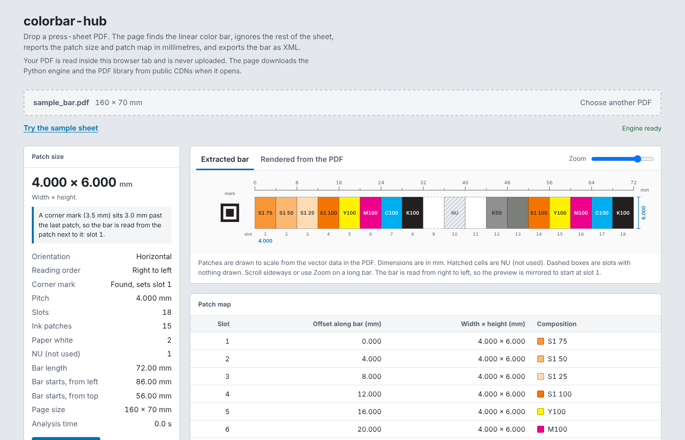

# colorbar-hub

Find the linear color bar in a press-sheet PDF, get the **patch size** and the
**patch map** in millimetres, and export the bar as **XML**. Built for recreating a color bar
template in color control software, so the system knows how to map measurement data to each patch.

**Live page:** `https://jinkaiqian-color.github.io/colorbar-hub/`



*The bundled sample sheet, which is synthetic. It has one real color bar with a corner mark at its right end, surrounded by decoy artwork. The bar is read from the patch next to the mark.*

## What it reports

- Patch width and height in mm, the pitch, the patch count and the empty slots
- Where the bar starts on the sheet (mm from the left and from the top) and which way it is read
- Whether a QR-style corner mark sits in line with the bar. If it does, the patch next to the
  mark is slot 1 and the bar is read away from it.
- Every slot of the bar, one row each, numbered 1, 2, 3, ... with no gaps. Each row has its offset
  along the bar and its composition, for example `K100`, `C100 M100`, `C50 M40 Y40`, `S1 75`,
  `Paper (no ink)` or `NU` (see [Slot types](#slot-types))
- Spot colors are labeled `S1`, `S2`, ... in order of appearance. Ink names and
  CMYK alternates are deliberately not shown.
- A preview of the extracted bar, drawn to scale, and optionally the same area
  rendered from the PDF
- An XML download of the bar, in the colorbar template format (see [XML export](#xml-export))

Horizontal and vertical bars are both supported. A bar can sit on a large sheet
with packaging artwork, dielines and registration marks around it. Those are ignored.

## Privacy

The page runs the analysis **inside your browser tab** (Python compiled to
WebAssembly). Your PDF is never uploaded. When the page opens it downloads the
Python engine ([Pyodide](https://pyodide.org)) and the [pypdf](https://pypi.org/project/pypdf/)
library from public CDNs, and the optional preview tab loads
[pdf.js](https://mozilla.github.io/pdf.js/) the same way. None of those requests
contain your file.

## How the bar is found

1. Every filled rectangle is collected with its size, position and ink. Images,
   text, curved shapes and shapes in production inks (dieline, registration
   `All`, cut, crease, ...) are set aside.
2. Rectangles of the same size are grouped. A color bar is a group on one
   straight line, advancing by a constant pitch, with at least three different fills.
3. The best-scoring line wins. Every slot along it gets its own row, numbered without gaps
   (see [Slot types](#slot-types)).
4. If a QR-style corner mark sits in line with the bar, just past one end, the patch next to
   it becomes the first patch (see below).

Ink names in the PDF decide what counts as production artwork, which is why this
works on separations and spot colors and not only on plain CMYK.

## XML export

The **Download XML** button (and `--xml` on the command line) writes the bar in the format of the colorbar
templates: `colorbar_<PDF name>.xml`.

```xml
<ColorBar Name="KB2014 MF 4C 3bx5mmh SW A IFG7">
	<TemplatePatch Width="3" Height="5" Type="DefaultPatch" />       the standard patch size, mm
	<ReferencePatches>                                               one definition per distinct patch
		<TemplatePatch Type="Tint" ID="P_HY">
			<PatchTypeData Slot="4" Raster="0.5" RasterClass="2" />
		</TemplatePatch>
		...
	</ReferencePatches>
	<TemplatePatches>                                                one reference per slot, in reading order
		<TemplatePatch rRef="P_HY" />
		...
	</TemplatePatches>
	<RasterSettings ...> ... </RasterSettings>
</ColorBar>
```

How a slot becomes a patch ID:

| Slot | Written as |
|---|---|
| single ink at 100% | `Solid`, ID `P_K`, `P_C`, `P_M`, `P_Y`, or `P_1`, `P_2`, ... for spot inks |
| single ink at 25, 50, 75% | `Tint`, ID `P_Q..`, `P_H..`, `P_T..` (for example `P_HK`, `P_QC`, `P_H2`), with `Raster` and `RasterClass` 1, 2, 3 |
| inks together at 100% | `Overprint`, ID `P_CM`, `P_CY`, `P_MY`, `P_CMY`, with an `InkList` |
| C/M/Y at 50/40/40, 25/19/19, 75/66/66 | `Balance` (`P_HR_CMY`, `P_HC_CMY`, `P_SC_CMY`) with its `GrayBalanceType` |
| no ink | `Paper`, ID `P_P` |
| S/D line patch, vertical lines | `Slur`, ID `P_0°K`, `P_0°C`, `P_0°M`, `P_0°Y`(spot inks `P_0°1`,...), with the ink `Slot` and `Type="Vertical"`|
| S/D line patch, horizontal lines | `Slur`, ID `P_90°K`, ..., with the ink `Slot` and `Type="Horizontal"`|
| NU | `NotUsed`, ID `P_NU` |

`Slot` inside a definition is the **ink slot**, not the position of the patch on the bar: Paper 0, K 1, C 2, M 3,
Y 4, and spot inks 5 and up. The spot inks are numbered in the order they first appear along the bar: the first
spot ink met gets slot 5 (`S1`, `P_1`), the next slot 6 (`S2`, `P_2`), and so on. The names of the inks in the PDF
play no part. The order follows the reading direction, so a bar that is read from the other end because of a corner
mark numbers its spot inks from that end.

Definitions are listed in order of first use. Anything that had to be adjusted is listed in a note on the page
and printed to stderr by the command line:

- a tint within 10 points of 25, 50 or 75% is written as that tint (a 60% patch becomes 50%, `P_H2`), and the
  page shows a warning that the PDF holds an unexpected tint
- a tint that is not near 25, 50 or 75%, an unknown overprint, or a gray-balance patch with other values is written
  as its own generic definition
- a cell split into parts is written as NU

Where a printed label disagrees with a patch, the label's tint is written unless the option to follow the labels is switched off 
(see Printed labels against the patches). The `RasterSettings` block is the same fixed block as in the templates. The layout is produced by `build_xml()` in
`colorbar_core.py`.

## S/D (slur and doubling) patches
 
A slur/doubling patch is a cell filled with fine parallel lines, vertical in one patch and horizontal in the next. The
lines are drawn as strokes, so they have no width in the outline of the page, and an earlier version read these cells as
paper white. A cell is now recognized as a **line patch** when it holds:
 
- at least **5 parallel straight lines**, all vertical or all horizontal, of the same width (at least 0.05 mm)
- in **one ink**, evenly spaced, and not overlapping into a solid
- spread over most of the cell
The patch map lists it as, for example, *S/D vertical lines K100 · 17 lines, 0.125 mm wide, 0.247 mm apart*, the summary
counts the S/D patches, and the preview draws the real lines. In the XML a vertical-line patch is `P_0°K` (angle 0°) and a
horizontal-line patch is `P_90°K`, as in the colorbar templates. The direction is the physical direction on the sheet, so
it does not change when a corner mark makes the bar read from the other end. Single thin lines (the tick marks between
groups) and fewer than 5 lines are not patches. Lines drawn as thin filled rectangles instead of strokes are not
recognized, and show as NU.

## Slot types

The patch map lists **every slot**, so the index never skips. Each slot is one of:

| Type | What it is |
|---|---|
| **ink** | A patch with ink. The row shows its composition, such as `K75` or `S1 50`. |
| **paper** | A slot with no ink: a white patch, or a slot where nothing is drawn. It reads `Paper (no ink)`. |
| **NU** | Not used. The slot holds a special mark instead of a measurement patch. |

A slot is **NU** when something other than a patch sits in it: a circle, a box or outline, tick marks,
an image, a small solid square, dot patterns, or text in a slot that has no patch. This holds whatever the
size of the mark, so a 1.4 mm square in a 3 mm slot is NU, not paper white. A mark on top of a patch makes
the slot NU too, and NU slots carry no ink in the S1, S2, ... numbering.

These do **not** make a slot NU:

- hairlines and zero-width tick lines, such as group separators
- an outline drawn exactly around a patch
- text written on a patch (a label)

A cell split into several parts across its width, such as a tint ladder, stays one slot. Its row shows the
parts in order, for example `K2 / K3 / K4 / K5`.

Patch positions come from a straight-line fit of position against slot number, so offsets sit on the grid.
A patch that is more than 0.05 mm off the grid is listed in a warning, and the offsets still use the grid position.

## Printed labels against the patches
 
Bars often print a percentage under each tint patch (`75%`, `50%`, `25%`). The tool reads those labels, matches each
to the patch it sits under, and compares the printed value with the tint the patch is drawn in. When they disagree
the file contradicts itself, and the page shows a warning such as *"The printed label says 75% but the patch is
C 100% at slots 13 and 45."* The slot's row in the patch map reads *label says 75%*.
 
In the XML the tool **follows the printed label** by default, so a patch labelled 75% and drawn at 100% is written as
75% (`P_TC`), with a note. Untick **Follow the printed labels** to keep every patch as drawn instead (`--as-drawn` on
the command line). The option only appears when there is a disagreement.
 
The check applies only to:
 
- labels that are plain text in the PDF and read exactly as a percentage (`75%`), within 8 mm of the bar
- patches made of a single ink. A label over a gray-balance or overprint patch is not compared.
- labels that are the standard tints 25, 50, 75 or 100% when the XML follows the label
Labels that were converted to outlines, or that use an unusual font encoding, cannot be read and are skipped
without any warning. The standard-tint warning (a 60% patch among 25, 50 and 75%) still catches odd values then.
 
## Step and repeat
 
A production file often carries the colorbar design several times, stepped and repeated until the bar fills the
sheet (a 40 inch sheet, for example), while the template holds the core design once. When that happens the page
**shows and exports one core only** and flags the repeats: how many copies, the length of the whole run, and the
distance between copies.
 
A repeat is found when:
 
- the same design appears at least **2 whole times**, and every slot of every copy matches (ink, tint, paper or NU)
- the core has at least **4 slots**
- the last copy may be cut short, because a bar ends at its last patch
The copies can sit in any of three ways, and all three are handled:
 
| Copies are | Example |
|---|---|
| on one grid, touching | the step is a whole number of patches, such as 64 patches of 4.0625 mm |
| on one grid, with empty slots between them | the gap is a whole number of patch widths |
| each on its own grid | the step is any other distance, such as the template's page width |
 
Identical bars on separate lines (the same bar repeated across the sheet) are folded into one as well. Copies placed
as a reusable form XObject, the usual way a step and repeat is made, are found like copies drawn directly.
 
The core is the first copy in reading order, or the copy next to a corner mark when there is one. Its position, size and
preview crop are those of the core alone, and the XML is exactly the XML of the core design. A bar that is only
nearly periodic, with one slot different in a later copy, is not folded and shows as one long bar.
 
A tint ladder stacked in one cell (like the 2 to 5% bars in the TCS C4 template) is part of that cell and is never
reported as a bar of its own.

## Corner marks and the first patch

Some bars carry a QR-style corner mark at one end: three concentric squares in the ratio
7 : 5 : 3 (a QR finder pattern). When one is found, the patch next to it is **slot 1** and
the bar is read away from it, whichever way that runs on the sheet.

A mark counts only if all of this is true:

- it is in line with the bar, with its centre within 30% of the bar's thickness of the bar's centre line
- it sits entirely past one end of the bar, not on top of it
- it is no farther from the bar than three patch lengths or 15 mm, whichever is larger

Which end the mark is at decides the reading order:

| Mark is at | Reading order | Slot 0 is |
|---|---|---|
| right end of a horizontal bar | right to left | the right-most patch |
| left end of a horizontal bar | left to right | the left-most patch |
| bottom end of a vertical bar | bottom to top | the bottom patch |
| top end of a vertical bar | top to bottom | the top patch |
| no mark | left to right, or top to bottom | the first patch in that direction |

If marks are found at both ends the order is left unchanged and a warning is shown.
Spot colors are numbered `S1`, `S2`, ... in order of appearance from slot 1, so reading from
the other end can change which spot is `S1`.

The result reports the mark's size, its module size (0.5 mm on the bundled sample), its distance from the bar,
the reading direction and where reading starts (`start_mm`: the outer edge of slot 1, in mm from
the left and top of the page). The mark itself is not a patch and is not in the patch map.

## Limits

- The bar must be live vector artwork. A bar placed as an image, or converted to
  outlines, cannot be read.
- A corner mark is recognized by its shape only. The page does not read any data from it.
- Spot-color preview swatches are approximate. The patch map does not depend on them.
- Rotated pages are reported in unrotated page coordinates.
- Coating plates (varnish) are numbered like spot colors and flagged with a warning,
  because a densitometer usually does not read them.
- Very large sheets are slower in the browser than on the command line. An 87 MB
  press sheet takes about 9 seconds with the command-line tool.

## Run it locally

The page needs to be served over HTTP (browsers block module workers on `file://`):

```bash
python tools/build_site.py
python -m http.server -d _site 8000
# open http://localhost:8000
```

It still downloads Pyodide and pypdf from the CDNs, so it needs internet access.

### Command line

```bash
pip install -r requirements.txt
python colorbar_hub.py sheet.pdf          # readable summary
python colorbar_hub.py sheet.pdf --json   # everything as JSON
python colorbar_hub.py sheet.pdf --xml    # the bar as an XML document
```

### As a library

```python
import colorbar_core as core

result = core.analyze("sheet.pdf")          # or bytes, or an open binary file
bar = result["candidates"][0]
print(bar["patch_w_mm"], bar["patch_h_mm"], bar["pitch_mm"])
```

## Repository layout

| Path | What it is |
|---|---|
| `colorbar_core.py` | The engine. Pure Python plus pypdf. The same file runs under CPython and in the browser. |
| `colorbar_hub.py` | Command-line wrapper |
| `site/` | The web page: `index.html`, `style.css`, `app.js`, `worker.js` |
| `tools/build_site.py` | Assembles `_site/` (page + engine + sample) for hosting |
| `tests/` | Unit tests, the synthetic sample generator, and a browser test |
| `.github/workflows/` | Tests and the GitHub Pages deployment |

## Development

```bash
pip install -r requirements-dev.txt
python -m pytest -q tests --ignore=tests/e2e     # unit tests
python tests/make_sample.py                      # regenerate tests/sample/sample_bar.pdf
```

The browser test downloads Pyodide, so it needs internet access:

```bash
pip install playwright && playwright install chromium
python tools/build_site.py
python -m pytest -q tests/e2e
```


